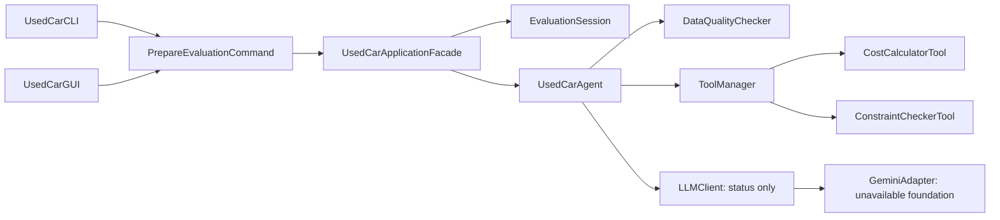

# Stage 2 foundation architecture

This foundation implements the deterministic preparation part of Stage 1 SD02, with manual record creation from UC01. It is a single Java 21 desktop/CLI application, with no runtime dependencies beyond the JDK. It does not yet implement an autonomous reasoning agent.

## Package responsibilities

All package paths below are under `src/main/java/ca/yorku/eecs3311/usedcar/`.

| Package | Existing responsibilities | Planned extensions |
|---|---|---|
| `app` | Main modes, dependency composition, shared facade, in-memory session | Comparison slot, clarification history, evidence versioning and persistence |
| `ui` | Swing/CLI invokers, shared input schema/parsing and result presentation | Additional feature panels/commands, async AI work, separate save actions |
| `command` | Typed `Command<R>` and concrete deterministic preparation request | Original AnalyzeListing/EvaluateVehicle/CompareVehicles/GenerateChecklist commands |
| `domain` | Validated immutable Vehicle, UserPreference, explicit CostAssumptions; shared invariants | Draft vehicle/provenance and explicit evaluation mode after design review |
| `result` | CostEstimate, ConstraintViolation, MissingInformationResult, PreparationResult | VehicleKnowledge, RiskAssessment, VehicleComparison, InspectionChecklist, EvaluationReport |
| `tool` | Checked tool dispatch, precise arithmetic, budget/mileage checks, basic unknown-field detection | Complete constraints, data conflicts and VehicleKnowledgeTool |
| `agent` | Initial deterministic tool coordination, injected LLM abstraction | Evidence gathering, strategy application, clarification/resumption and validated LLM workflows |
| `llm` | Provider-independent contract and explicitly unavailable Gemini adapter | Safe configuration, HTTP transport, PromptBuilder, ResponseParser |
| `repository` (planned) | No artificial empty class created | Local JSON/CSV VehicleKnowledgeRepository with provenance and no-match handling |
| `strategy` (planned) | No disconnected strategies created | EvaluationStrategy, three policies, EvaluationStrategyFactory and documented factory refinement |

## Working data flow

1. GUI or CLI obtains strings using the shared `PreparationForm` field list. The demo loads **input** from `example.properties`; it never loads precomputed results.
2. Input conversion creates immutable domain objects. Their constructors validate required fields, nonnegative values and numeric ranges. Unknown history is explicit `UNKNOWN`; missing numeric assumptions are null, never zero.
3. `PrepareEvaluationCommand.execute()` calls the facade. The agent runs the quality checker and dispatches actual cost and constraint tools.
4. A `PreparationResult` snapshots inputs and computed results. Only after successful computation does the facade update the session, preserving prior state on failure.
5. Both interfaces use the same formatter. Business calculations exist only in tools; UI code handles text and user actions.

No result cache exists yet, so editing input cannot accidentally reuse an old AI assessment. Future evidence caches must be keyed by vehicle and preference revision; invalidation is required before F12.

The session initially has zero vehicles and a neutral preference; after saving it has one current vehicle. Comparison vehicle and clarification history are intentionally deferred. Domain objects and list/set values are immutable, preventing external mutation of saved state.

## Patterns and useful roles

- **Facade — working:** UI requests cross one application boundary; tool dispatch, session updates and LLM availability are hidden behind it.
- **Command — working for this initial slice:** both invokers execute the same `PrepareEvaluationCommand`; it captures the vehicle, buyer profile and assumptions and delegates to the facade. Original AI commands remain planned.
- **Adapter — foundation only:** `GeminiAdapter implements LLMClient`, but no protocol conversion exists. This is not counted as a completed Adapter implementation.
- **Strategy — planned:** preserve `buildPriorityGuidance(UserPreference)` and the three named concrete policies when evidence-backed synthesis is implemented. Guidance must actually affect a prompt/workflow, not merely print a strategy name.
- **Factory — planned:** preserve `EvaluationStrategyFactory.createStrategy(preference)` as the recognizable construction boundary. `ApplicationFactory` is just a composition helper and is not a course pattern claim. See the formal Factory Method correction proposal in DESIGN_DECISIONS.

Dependency injection is ordinary constructor injection; no framework is necessary. The agent depends on `LLMClient`, not on Gemini implementation details. Swing's event thread currently runs only short local calculations. Future HTTP/retrieval work must use a background worker and return UI updates to the EDT.

## Calculation and safety boundaries

Currency is CAD by demonstration convention; no exchange-rate, tax-law or market-data lookup occurs. Annual litres = annual km × L/100 km ÷ 100. Fuel cost = litres × CAD/L. Optional tax = price × user-supplied fractional rate. A full simple first-year estimate requires fuel, tax, maintenance and insurance inputs; otherwise its value is unavailable and the missing assumptions are listed.

`Tool.execute(Object)` preserves the Stage 1 signature; each tool accepts one checked request record. `ToolManager` rejects duplicate names and missing tools. Results are converted with checked casts at the agent boundary. A future generic typed tool registry is optional, not required for this foundation.

There is no network client, real key, external service, knowledge claim, AI category, persistent user file or report export in the executable. All existing tools and records support deterministic verification without an LLM.
